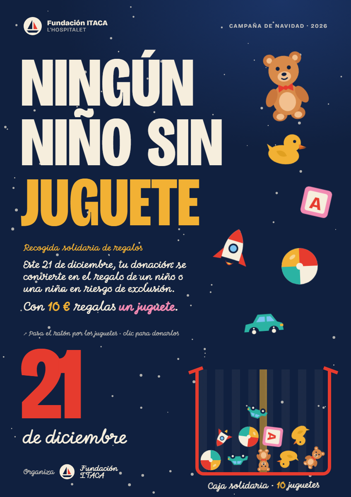

# Ningún niño sin juguete · Cartel interactivo

**Actividad 0612 · The Interactive Poster** — Fundación ITACA L'Hospitalet
Tema: **21 de diciembre · campaña de donación para comprar regalos de Navidad a niños y niñas en riesgo de exclusión.**



## Concepto

Los juguetes "flotan" por el cartel como si esperasen a que alguien los regale. Cuando el usuario se acerca a un juguete, este reacciona, enseña lo que cuesta y el mensaje cambia ("Con 12 € regalas un osito de peluche"). Si hace clic, el juguete cae dentro de la **caja solidaria**, que va sumando juguetes donados.

La interacción reproduce el gesto de la campaña: cada persona que participa llena un poco más la caja.

- Formato: 848 × 1200 px (A3 vertical), escalado proporcionalmente a la ventana sin deformarse.
- Paleta navideña: azul noche, crema, rojo, mostaza, turquesa y rosa.
- Tipografía: *Bricolage Grotesque* (Google Fonts) en versión condensada para el titular y *Momo Signature* (manuscrita) para los textos de la parte inferior.
- Ilustraciones de los juguetes hechas en SVG propio.

## Estructura

```
index.html        → maquetación del cartel y símbolos SVG de los juguetes
style.css         → estilos y composición
main.js           → toda la lógica de interacción
libs/matter.min.js→ librería de física Matter.js (copia local)
captura.png       → captura del estado final
```

## Eventos de JavaScript utilizados

Todos se registran con `addEventListener()`.

| Evento | Elemento | Función |
|---|---|---|
| `mouseenter` | cada juguete `.toy` | `handleToyEnter()` |
| `mouseleave` | cada juguete `.toy` | `handleToyLeave()` |
| `mousemove` | el cartel `#poster` | `handlePosterMove()` |
| `mouseenter` / `mouseleave` | el cartel `#poster` | `handlePosterEnter()` / `handlePosterLeave()` |
| `click` | cada juguete `.toy` | `donateToy()` |
| `resize` | `window` | `fitPoster()` |

## Las interacciones

### 1 · mouseenter: el juguete se ilumina
Al entrar con el cursor en un juguete:
- crece (`scale`) y se balancea (`rotate`) mediante `transform`;
- se le aplica un brillo dorado con `filter: drop-shadow(...)` y sube de `z-index`;
- aparece una etiqueta con su precio (`left`, `top` y clase `is-visible`);
- el texto del mensaje cambia: **"Con 12 € regalas un osito de peluche."**
- cada juguete arranca **su propia animación** (se añade la clase `is-active` y un efecto de partículas programado en `TOY_EFFECTS`):

| Juguete | Animación |
|---|---|
| Cohete | Tira fuego y humo por el motor, tiembla y despega un poco |
| Osito | Guiña un ojo, mueve las orejas, se sonroja y suelta corazones |
| Patito | Abre el pico, dice "¡Cuac!", se balancea y suelta burbujas |
| Coche | Giran las ruedas, enciende los faros, avanza y echa humo |
| Pelota | Bota y gira, y suelta chispas al tocar el suelo |
| Bloque | Va deletreando J‑U‑G‑A‑R, cambia de color y lanza confeti |

Las partículas (fuego, corazones, humo, confeti...) se crean y se mueven desde JavaScript en el bucle `requestAnimationFrame` (`spawnParticle()` y `updateParticles()`).

### 2 · mouseleave: vuelve a su estado inicial
Al salir, `handleToyLeave()` quita el brillo, oculta la etiqueta y restaura el mensaje por defecto ("Con 10 € regalas un juguete"). La escala y el giro vuelven poco a poco a su valor original gracias a una interpolación en el bucle de animación.

### 3 · mousemove: el cartel sigue al cursor
Con las coordenadas del ratón (convertidas a coordenadas internas del cartel con `toPosterCoords()`):
- **Titular:** cada letra de "NINGÚN NIÑO SIN JUGUETE" está en su propio `<span>`. Las letras cercanas al cursor saltan, giran y cambian de **color** (`updateLetters()`).
- **Parallax:** los juguetes se desplazan en sentido contrario al ratón según su profundidad (`data-depth`), lo que da sensación de capas.
- **Luz:** un halo dorado sigue al cursor (variables CSS `--mx` / `--my`).
- **Nieve:** el viento cambia de dirección según la posición horizontal del ratón.
- **Caja solidaria:** el cursor empuja los juguetes que ya están dentro de la caja (fuerzas de Matter.js).

### Extra · click: donar un juguete
Al hacer clic en un juguete, este desaparece del cartel y cae con física real dentro de la caja; el contador "Caja solidaria · N juguetes" aumenta. A los pocos segundos el juguete vuelve a aparecer para que se pueda seguir donando.

## Requisitos técnicos cumplidos

- Tres interacciones de ratón programadas en JS (`mouseenter`, `mouseleave`, `mousemove`) además de `click`.
- Propiedades visuales modificadas desde JS: `transform`, `filter`, `opacity`, `color`, `z-index`, `left/top` y variables CSS.
- Funciones propias para cada interacción (`handleToyEnter`, `handleToyLeave`, `handlePosterMove`, `updateLetters`, `donateToy`...).
- Las transiciones CSS solo suavizan los cambios; el comportamiento lo controla JavaScript.
- Sin errores en la consola. Si Matter.js no se carga, la caja sigue contando las donaciones sin física.

## Cómo verlo

Abre `index.html` en el navegador (no necesita servidor).

**Captura del estado final:** abre `index.html?captura`. El cartel se muestra a tamaño real (848 × 1200) y la caja aparece ya llena de juguetes.

## Créditos

- Física: [Matter.js](https://brm.io/matter-js/) (MIT).
- Tipografía: Bricolage Grotesque, Google Fonts.
- El logotipo de Fundación ITACA es una versión simplificada para el ejercicio; para la entrega final puede sustituirse por el logo oficial.
